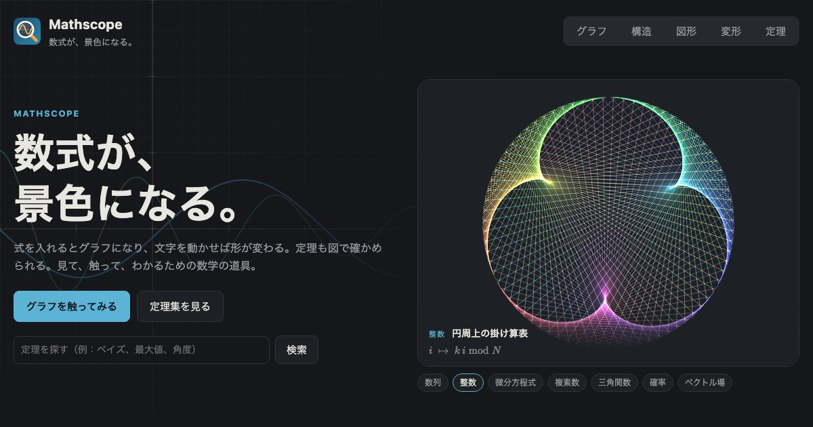

# Mathscope

数式が、景色になる。

式を入れるとグラフになり、文字を動かせば形が変わる。定理も図で確かめられる。見て、触って、わかるための数学の道具。

**https://kotta-27.github.io/mathscope/**



## できること

| タブ | 内容 |
|---|---|
| ホーム | 13 種類のアニメーション（ヒマワリ、マンデルブロ集合、素数のらせん、ドラゴン曲線など）と、使い方の例 |
| グラフ | 式の中の x 以外の文字が自動でスライダーになり、動かすと形の変化が見える |
| 構造 | 式を木構造に分解し、各部分の役割（分子・底・引数など）と値を表示 |
| 図解 | 基本のしくみを動く図で: 単位円と三角関数、数列の極限（ε と N）、微分＝接線の傾き、積分＝面積、ベクトルの和と実数倍、複素数の掛け算＝回転、確率＝面積 |
| 式変形 | 展開・因数分解・整理（通分と約分）・方程式を解く・微分を 1 手ずつ再生し、書き換えた箇所を色で示す |
| 定理 | 12 分野・121 個の定理。すべてに条件・使いどころ・例題・動かせる図がある |

### 式の書き方

`x²` `√x` `sin 2x` `|x|` `ax+b` や全角文字、`\frac{1}{x}` `\sqrt{x}` `x^{2}` のような LaTeX もそのまま書ける。入力は mathjs が読める形に直してから解析し、読み方が入力と違うときは「読み取り:」で表示する。

| 入力 | 読み取り |
|---|---|
| `ｘ＋１` `2×x` `6÷3` | `x+1` `2*x` `6/3` |
| `x²` `x⁻¹` `√(x+1)` `|x|` | `x^2` `x^(-1)` `sqrt(x+1)` `abs(x)` |
| `sinx` `sin²x` `ln x` | `sin(x)` `sin(x)^2` `log(x)`（`log` だけなら自然対数） |
| `log10 x` `log_10(x)` `\log_{10} x` `lg x` `log₁₀x` | `log10(x)`（常用対数） |
| `log_2 8` `log_3(x+1)` `log_a x` | `log2(8)` `log(x+1, 3)` `log(x, a)` |
| `ax^2+bx+c` | `a*x^2+b*x+c`（2 文字以上の変数は 1 文字ずつの積。`pi` `theta` などは除く） |

### URL で状態を共有する

画面を触ると、その状態が URL に残る（履歴は増やさない）。ヘッダーの「リンクをコピー」で、いまの状態のまま開けるリンクをコピーできる。開いただけでは URL を書き換えない。

| URL | 開く状態 |
|---|---|
| `#graph?f=a*(x-p)^2+q&p=2&q=-1` | グラフに式を入れ、パラメータの値を指定して開く。`f` は複数書ける |
| `#graph?...&view=-4,4,-2,6&play=a` | 表示範囲（x の最小・最大、y の最小・最大）と、自動再生するパラメータ |
| `#structure?f=...&a=2` | 構造に式と文字の値を入れて開く |
| `#steps?mode=solve&f=x^2=5x-6&n=2` | 式変形の種類・式・何手目かを指定して開く（mode: `expand` `factor` `simplify` `solve` `derive`） |
| `#geometry?demo=circle&t=1.047&tan=1` | 単位円の角度と tan の表示 |
| `#geometry?demo=deriv&f=x^2&x0=1&h=0.5` | 微分デモの関数・接点・幅（`df=0` で導関数を隠す） |
| `#geometry?demo=integral&f=sin(x)&a=0&b=3&n=10&m=left` | 積分デモの関数・区間・分割数・方法（`left` `mid` `right` `trap`） |
| `#theorems?q=bayes&field=prob` | 定理集の検索語と分野 |
| `#theorems?id=bayes` | その定理のページを開く（図を動かした状態は `&v.<名前>=<値>` で残る） |
| `#home?scene=lorenz&t=8` | トップのアニメーションをそのシーン・時刻で止める |

## 誰のためのアプリか

主ペルソナは「習ったばかりの概念がピンとこない高校 1〜2 年生」、最初に満足させる相手は「授業で動きを見せる高校の数学教員」。ユースケースと優先順位は [docs/personas.md](docs/personas.md) にまとめた。

## 開発

```sh
npm install
npm run dev     # 開発サーバー（http://localhost:5173/mathscope/）
npm test        # 単体テスト（Vitest）
npm run lint
npm run build   # 型チェック + 本番ビルド
npm run e2e     # クリック操作の検証。開発サーバーと手元の Chrome が必要
```

`npm run e2e` は `E2E_BASE` で対象の URL、`CHROME_PATH` で Chrome の場所を変えられる（例: `E2E_BASE=https://kotta-27.github.io/mathscope/ npm run e2e`）。

### 開発の流れ

- 機能ごとに `dev/<内容>` のブランチを切り、PR を出す
- PR と main への push で CI（lint・テスト・ビルド）が走る
- main に入ると GitHub Actions で GitHub Pages にデプロイされる

### アクセス解析（任意）

Cookie を使わない [GoatCounter](https://www.goatcounter.com/) で、画面ごとの閲覧数と、図を触った・リンクをコピーした・検索が 0 件だった、などの出来事を数える。数える内容は [docs/personas.md](docs/personas.md) の「検証の方法」にある。

1. GoatCounter でサイトを作る（例: `mathscope`）
2. GitHub のリポジトリの Settings → Secrets and variables → Actions → Variables に `GOATCOUNTER_URL` を追加する（値の例: `https://mathscope.goatcounter.com/count`）
3. main に push すると、次のデプロイから有効になる

変数がないときは、解析のコードはビルドに含まれない。

## 構成

| パス | 内容 |
|---|---|
| `src/tabs/` | 各タブ。ホーム以外は開いたときに読み込む（`React.lazy`） |
| `src/hero/` | トップのアニメーション（Canvas）と背景 |
| `src/figures/` | 定理ごとの説明図。`index.tsx` で定理 id と対応付け、`ids.ts` に id の一覧 |
| `src/lib/theorems.ts` | 定理のデータ |
| `src/lib/normalize.ts` | 式の書き方の正規化 |
| `src/lib/steps.ts` | 式の展開を 1 手ずつ行うエンジン |
| `src/lib/transforms/` | 式変形の各モード（展開・因数分解・整理・方程式・微分）。どれも「1 手 = ラベル + 色付きの式」を返す |
| `src/components/` | グラフ描画（Plot）、数式の入力欄（MathInput）、KaTeX 表示など |
| `e2e/` | DevTools プロトコルでクリック操作を確かめるスクリプト |

技術: Vite + React + TypeScript、[KaTeX](https://katex.org/)、[math.js](https://mathjs.org/)
